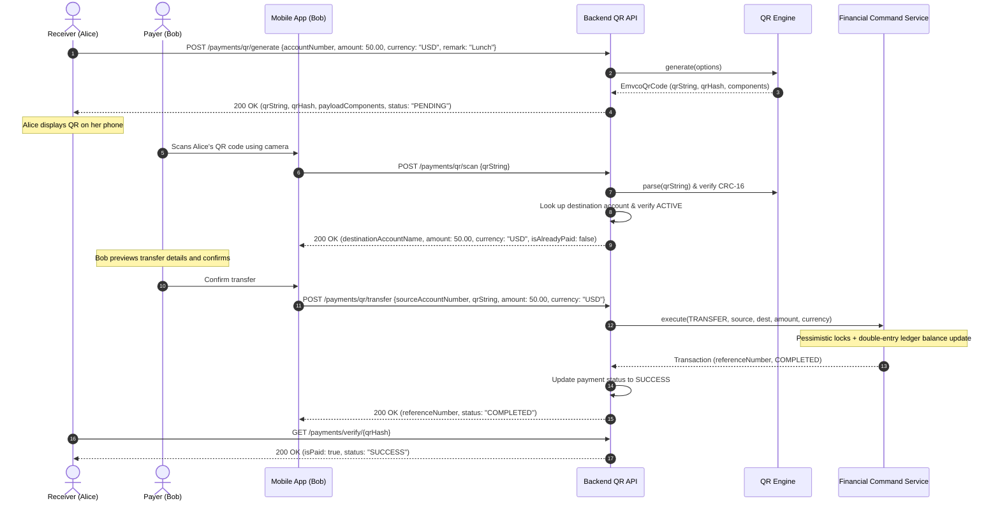

# Native EMVCo QR Payment System Specification & Documentation

## 1. Overview & Architectural Motivation

This document details the in-house **EMVCo QR Payment Engine** designed and implemented to replace external dependencies on the Bakong KHQR SDK (`kh.gov.nbc.bakong_khqr:sdk-java`) and NBC Bakong OpenAPI endpoints.

### Key Motivations:
- **Zero External Proprietary Dependencies:** The banking platform no longer relies on closed external SDKs or external settlement servers.
- **Full Standard Parity:** Built completely from scratch following the international **EMVCo Merchant-Presented Mode (MPM) QR Code Specification** (which KHQR is based upon).
- **Comprehensive Backend-Driven Generation:** The backend generates the compliant EMVCo QR payload and returns both the raw string, verification hash, and detailed payload components so frontends can easily render and brand the QR code without needing any complex decoding logic.
- **Full Scan-to-Transfer Integration:** Allows users to scan any compliant QR code via camera, preview recipient details, validate the amount and currency, and execute atomic double-entry ledger transfers with audit logging and duplicate protection.

---

## 2. EMVCo Merchant-Presented Mode (MPM) QR Standard

The QR code is serialized using **TLV (Tag-Length-Value)** encoding:
- **Tag:** Exactly 2 numeric characters (`TT`) identifying the data element.
- **Length:** Exactly 2 numeric characters (`LL`) defining the byte length of the value.
- **Value:** The string content (`VV...`) of length `LL`.

```
Format: [Tag: 2][Length: 2][Value: L chars]...[Tag 63: 04][CRC-16: 4 hex chars]
Example: 00020101021229340018bank@digitalbank011090000000010212Digital Bank520459995303840540550.005802KH5910Alice Demo6010Phnom Penh6304E3A9
```

### 2.1 TLV Data Object Dictionary

| Tag | Name | Format / Length | Description | Example |
| :--- | :--- | :--- | :--- | :--- |
| **`00`** | Payload Format Indicator | Fixed, 2 chars | Must always be `"01"` per EMVCo standard | `000201` |
| **`01`** | Point of Initiation Method | Fixed, 2 chars | `"11"` = Static (reusable, customer enters amount), `"12"` = Dynamic (single-use, preset amount) | `010212` |
| **`29`** | Account Information Template | Variable (nested TLV) | Contains receiving account, bank GUID, acquiring bank code | `2934...` |
| ↳ `00` | Global Unique Identifier (GUID) | Up to 32 chars | System identifier for the banking scheme | `0018bank@digitalbank` |
| ↳ `01` | Account Identifier | Up to 32 chars | Account number (e.g. `9000000001` or `9000000001@digitalbank`) | `01109000000001` |
| ↳ `02` | Acquiring Bank Name | Up to 25 chars | Name of acquiring financial institution | `0212Digital Bank` |
| **`52`** | Merchant Category Code (MCC) | Fixed, 4 chars | ISO 18245 MCC code (Default: `"5999"` for retail/services) | `52045999` |
| **`53`** | Transaction Currency | Fixed, 3 chars | ISO 4217 Numeric Currency (`"840"` for USD, `"116"` for KHR) | `5303840` |
| **`54`** | Transaction Amount | Variable, up to 13 chars | Formatted transaction amount (2 decimals for USD) | `540550.00` |
| **`58`** | Country Code | Fixed, 2 chars | ISO 3166-1 alpha-2 country code (`"KH"`) | `5802KH` |
| **`59`** | Merchant / Payee Name | Variable, up to 25 chars | Receiver's display name | `5910Alice Demo` |
| **`60`** | Merchant City | Variable, up to 15 chars | City name (Default: `"Phnom Penh"`) | `6010Phnom Penh` |
| **`62`** | Additional Data Template | Variable (nested TLV) | Transaction metadata | `6225...` |
| ↳ `01` | Bill / Invoice Number | Variable, up to 25 chars | Order / Invoice number | `0108BILL-889` |
| ↳ `05` | Reference Label | Variable, up to 25 chars | Tracking / Reconciliation ID | `0506REF101` |
| ↳ `08` | Purpose of Transaction | Variable, up to 50 chars | Transfer note / remark | `0805Lunch` |
| **`63`** | Checksum (CRC-16) | Fixed, 4 chars | CRC-16/CCITT-FALSE calculated over all preceding characters + `6304` | `6304E3A9` |

### 2.2 CRC-16/CCITT-FALSE Specification

The checksum tag (`6304`) is verified and calculated using:
- **Algorithm:** CRC-16/CCITT-FALSE (ISO/IEC 13239)
- **Polynomial:** `0x1021` ($x^{16} + x^{12} + x^5 + 1$)
- **Initial Value:** `0xFFFF`
- **Input Reflected:** `false`
- **Result Reflected:** `false`
- **Final XOR:** `0x0000`
- **Output:** 4 uppercase hexadecimal characters.

```java
public static String calculate(String payloadWithoutCrcValue) {
    byte[] bytes = payloadWithoutCrcValue.getBytes(StandardCharsets.UTF_8);
    int crc = 0xFFFF;
    for (byte b : bytes) {
        crc ^= (b & 0xFF) << 8;
        for (int i = 0; i < 8; i++) {
            if ((crc & 0x8000) != 0) {
                crc = ((crc << 1) ^ 0x1021) & 0xFFFF;
            } else {
                crc = (crc << 1) & 0xFFFF;
            }
        }
    }
    return String.format("%04X", crc);
}
```

---

## 3. End-to-End Scan-to-Transfer Workflow



---

## 4. REST API Endpoint Reference

Base URL: `/api/v1/payments`  
Authentication: `Authorization: Bearer <JWT_ACCESS_TOKEN>`

### 4.1 Generate QR Code
**`POST /api/v1/payments/qr/generate`**

Generates an EMVCo-compliant QR code string along with all decomposed metadata for client-side rendering.

#### Request Body:
```json
{
  "accountNumber": "9000000001",
  "amount": 50.00,
  "currency": "USD",
  "remark": "Lunch split",
  "billNumber": "INV-1002",
  "qrType": "DYNAMIC"
}
```
*Notes:*
- `amount` is optional. If omitted or 0, `qrType` defaults to `"STATIC"`.
- `currency` accepts `"USD"` or `"KHR"`.
- `qrType` accepts `"DYNAMIC"` or `"STATIC"`.

#### Response Body (`200 OK`):
```json
{
  "success": true,
  "message": "QR code generated successfully",
  "data": {
    "qrString": "00020101021229340018bank@digitalbank011090000000010212Digital Bank520459995303840540550.005802KH5910Alice Demo6010Phnom Penh62190108INV-10020811Lunch split6304E3A9",
    "qrHash": "8f14e45fceea167a5a36dedd4bea2543",
    "md5Hash": "8f14e45fceea167a5a36dedd4bea2543",
    "accountNumber": "9000000001",
    "payeeName": "Alice Demo",
    "amount": 50.00,
    "currency": "USD",
    "qrType": "DYNAMIC",
    "status": "PENDING",
    "remark": "Lunch split",
    "billNumber": "INV-1002",
    "acquiringBank": "Digital Bank",
    "payloadComponents": {
      "accountNumber": "9000000001",
      "accountIdentifier": "9000000001@digitalbank",
      "payeeName": "Alice Demo",
      "currency": "USD",
      "currencyCode": "840",
      "amount": "50.00",
      "qrType": "DYNAMIC",
      "countryCode": "KH",
      "merchantCity": "Phnom Penh",
      "acquiringBank": "Digital Bank",
      "crc": "E3A9",
      "remark": "Lunch split",
      "billNumber": "INV-1002"
    },
    "createdAt": "2026-10-23T09:40:00"
  }
}
```

---

### 4.2 Scan & Preview QR Code
**`POST /api/v1/payments/qr/scan`**

Used by the camera scanner to decode the raw QR string, verify the CRC-16 checksum, and resolve payee and account details before Bob confirms the transfer.

#### Request Body:
```json
{
  "qrString": "00020101021229340018bank@digitalbank011090000000010212Digital Bank520459995303840540550.005802KH5910Alice Demo6010Phnom Penh62190108INV-10020811Lunch split6304E3A9"
}
```

#### Response Body (`200 OK`):
```json
{
  "success": true,
  "message": "QR code scanned and validated successfully",
  "data": {
    "valid": true,
    "qrString": "00020101021229340018bank@digitalbank011090000000010212Digital Bank...",
    "qrHash": "8f14e45fceea167a5a36dedd4bea2543",
    "destinationAccountNumber": "9000000001",
    "destinationAccountName": "Alice Demo",
    "amount": 50.00,
    "currency": "USD",
    "isDynamic": true,
    "acquiringBank": "Digital Bank",
    "remark": "Lunch split",
    "billNumber": "INV-1002",
    "isAlreadyPaid": false
  }
}
```

---

### 4.3 Transfer Money by Scanned QR
**`POST /api/v1/payments/qr/transfer`**

Executes an immediate funds transfer debited from the sender's account to the recipient encoded in the scanned QR code.

#### Headers:
- `Authorization: Bearer <TOKEN>`
- `Idempotency-Key: <UUID>` *(Optional: prevents duplicate charges on network retries)*

#### Request Body:
```json
{
  "sourceAccountNumber": "9000000002",
  "qrString": "00020101021229340018bank@digitalbank011090000000010212Digital Bank...",
  "amount": 50.00,
  "currency": "USD",
  "remark": "Lunch with Alice"
}
```

#### Response Body (`200 OK`):
```json
{
  "success": true,
  "message": "Transfer by QR completed successfully",
  "data": {
    "referenceNumber": "TXN-20261023-A1B2C3",
    "status": "COMPLETED",
    "sourceAccountNumber": "9000000002",
    "destinationAccountNumber": "9000000001",
    "destinationAccountName": "Alice Demo",
    "amount": 50.00,
    "currency": "USD",
    "remark": "Lunch with Alice",
    "timestamp": "2026-10-23T09:41:00"
  }
}
```

#### Error Responses:
- `400 BAD_REQUEST`: `"INVALID_REQUEST"` (e.g., transfer to self, or source account inactive).
- `400 BAD_REQUEST`: `"AMOUNT_MISMATCH"` (when user enters an amount different from a fixed dynamic QR invoice).
- `400 BAD_REQUEST`: `"CURRENCY_MISMATCH"` (when source account currency differs from QR currency).
- `400 BAD_REQUEST`: `"INSUFFICIENT_FUNDS"` (when payer balance is insufficient).
- `409 CONFLICT`: `"PAYMENT_ALREADY_COMPLETED"` (when attempting to pay a dynamic QR that was already settled).

---

### 4.4 Verify Payment Status
**`GET /api/v1/payments/verify/{qrHash}`**

Allows receivers or merchants to poll the status of a generated QR payment.

#### Response Body (`200 OK`):
```json
{
  "md5Hash": "8f14e45fceea167a5a36dedd4bea2543",
  "status": "SUCCESS",
  "isPaid": true
}
```

---

### 4.5 Merchant QR Configuration
**`GET /api/v1/merchants/{id}/qr-config`**  
*(Legacy alias: `/api/v1/merchants/{id}/khqr-config`)*

Retrieves merchant profile details and a pre-computed static EMVCo QR code for counter displays.

#### Response Body (`200 OK`):
```json
{
  "merchantId": "MCH-100293",
  "storeName": "Coffee House",
  "merchantAccountId": "coffee_house@bank",
  "bakongAccountId": "coffee_house@bank",
  "merchantCity": "Phnom Penh",
  "mcc": "5999",
  "acquiringBank": "Digital Bank",
  "staticQrString": "00020101021129350018bank@digitalbank0111coffee_house@bank0212Digital Bank5204599953038405802KH5912Coffee House6010Phnom Penh6304C1E4"
}
```

---

### 4.6 Legacy KHQR Compatibility
**`POST /api/v1/payments/khqr/generate`**

Maintained for backward compatibility. Generates the EMVCo QR string using the scratch engine without requiring the NBC Bakong SDK.

---

## 5. Frontend Integration Guide

The user requested: *"Make the backend to send the data that need to generate the QR code first and no need to touch frontend."*

When the frontend is ready to integrate, here is how it works:

### 5.1 Receiving Money (Rendering QR)
1. Frontend calls `POST /api/v1/payments/qr/generate`.
2. The response returns:
   - `qrString`: Feed this directly into any standard QR component (e.g. `react-native-qrcode-svg`, `<QRCode value={data.qrString} />`).
   - `payloadComponents`: Use this to display branded UI details on the screen (payee name, currency, formatted amount, merchant bank logo).
   - `qrHash`: Poll `GET /api/v1/payments/verify/{qrHash}` every 3 seconds to detect when the payment succeeds and display the green "Payment Received" checkmark.

### 5.2 Paying by Scanning (Camera Scanner)
1. Mobile camera scans QR code to obtain the raw string (`qrString`).
2. Call `POST /api/v1/payments/qr/scan` with `{ "qrString": scannedText }`.
3. Display the confirmation screen showing `destinationAccountName`, `amount`, and `currency`.
4. User taps "Confirm & Pay".
5. Call `POST /api/v1/payments/qr/transfer` to execute the transaction.
